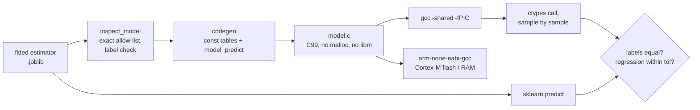

# sklearn2c

**Turn a fitted scikit-learn model into one dependency-free C99 function for a microcontroller, and prove it predicts exactly what sklearn predicts by compiling and running the C.** For firmware and ML engineers who want a tree, forest or linear model on an MCU without a runtime.


```bash
pip install .                                    # Python >= 3.9, needs gcc on PATH for --verify
python examples/train_fault_classifier.py        # synthetic sensor data, labels 10/20/30 -> fault_tree.joblib
sklearn2c fault_tree.joblib -o fault_tree.c --verify-data fault_test.csv
```

## Key results

| Result | Value | Setup |
|---|---|---|
| Compiled C vs `sklearn.predict`, 15 estimator types | **0 mismatches / 32,062 samples** | synthetic `make_classification`/`make_regression`, seed 0; held-out + random + on-threshold probes; gcc 11.4 `-O2` via ctypes |
| Decision tree (max_depth=8) | **2.9 ns/sample**, 1,652 B Cortex-M4 flash | latency on x86 VM, not a microcontroller: Intel(R) Xeon(R) Processor |
| Random forest (50 trees, max_depth=8) | **1.92 us/sample**, 80.4 KiB Cortex-M4 flash | same |
| Multiclass LogisticRegression (3 classes, 8 features) | **14.2 ns/sample**, 264 B Cortex-M4 flash | same |
| Bare-metal Cortex-M4F firmware with the 20-tree fault forest | **4,276 B flash / 132 B RAM** (+ stack) | `examples/arm_cortex_m/build.sh`, arm-none-eabi-gcc 10.3.1 `-Os`, linked, not run |
| Linear classifier probed at 0 to 1e-4 relative distance from its decision boundary | **0/2100 wrong labels** beyond the float rounding bound (6e-7); float flips only below it | reference = exact sign of z, checked on every CI combination; see Numeric limits |

All numbers: `python benchmarks/parity_table.py` and `bash showcase/make_showcase.sh`, run on x86 VM, not a microcontroller: Intel(R) Xeon(R) Processor.



## Using the generated C

```c
#include <stdint.h>
extern int32_t model_predict(const float *x);      /* classifiers: returns the sklearn label (classes_) */
/* regressors:  SKLEARN2C_REAL model_predict(const float *x);  float by default */

float x[4] = {0.41f, 1.2f, 3.9f, 41.0f};           /* same feature order as model.fit(X) */
int32_t fault = model_predict(x);                   /* 10, 20 or 30 - not a class index */
```

- One translation unit, only `<stdint.h>`, `const` tables (flash), no heap, no `math.h`: classifiers take the `argmax` of the decision function, which equals the `argmax` of the probabilities, so no `exp` is needed.
- Classifiers also export `<prefix>_predict_index(x)` (index into `classes_`) and the `<prefix>_CLASSES` table.
- `--prefix motor` renames everything to `motor_predict`, so several models can live in one firmware.
- `--main` appends a `main()` that reads features from `argv` for quick host testing.

### Python API

```python
from sklearn2c import transpile, verify_predictions

c_source = transpile(model, prefix="model")        # str, raises UnsupportedModelError / UnsupportedLabelError
report = verify_predictions(model, c_source, X_test)  # compiles with gcc, calls it via ctypes
assert report.ok, report.summary()                 # report.mismatches -> [(row, sklearn, c), ...]
```

Without `X`, `verify_predictions` builds probe inputs: random rows inside the feature ranges plus, for trees, the float32 value **exactly on every split threshold and one ULP above it**.

## Supported models

Detection is an exact class-name allow-list; anything else (KNN, SVC, GradientBoosting, Pipeline, a subclass with a lookalike name, an unfitted model, multi-output) raises `UnsupportedModelError` instead of producing C.

| Family | Estimators | Output |
|---|---|---|
| Trees | `DecisionTreeClassifier`, `DecisionTreeRegressor`, `ExtraTreeClassifier`, `ExtraTreeRegressor` | nested `if` |
| Forests | `RandomForestClassifier`, `RandomForestRegressor`, `ExtraTreesClassifier`, `ExtraTreesRegressor` | compact preorder node tables, deduplicated leaves |
| Linear regression | `LinearRegression`, `Ridge`, `Lasso`, `ElasticNet` | dot product |
| Linear classifiers | `LogisticRegression` (binary + multiclass), `RidgeClassifier`, `LinearSVC` | `argmax` of `coef_ @ x + intercept_` |

**Label contract.** Classifiers return `int32_t` labels taken from `classes_` (so a model trained on `10/20` returns `10/20`; the original version of this repo returned `0/1`). Labels must be integers, booleans or integer-valued floats in the `int32_t` range. String, fractional, NaN or out-of-range labels raise `UnsupportedLabelError` with the fix: encode with `LabelEncoder` and keep `le.classes_` on the host.

## Numeric limits

| Topic | Behaviour |
|---|---|
| Inputs | `const float *x` (float32). sklearn trees also cast `X` to float32, so this is not a loss for trees. |
| Tree thresholds | Emitted as the largest float32 `<=` the float64 threshold, so `x <= t` routes every float32 input exactly as sklearn does. Covered by on-threshold and one-ULP-above probes. |
| Classification parity | Exact label equality, no tolerance. |
| Regression parity | `abs(C - sklearn) <= 1e-5 * max(1, abs(y), sum(abs(w * x)))` (`sklearn2c.parity.REG_RTOL`). Max error observed is in the table below. |
| Linear accumulator | `SKLEARN2C_REAL`, `float` by default. If \|z\| > gamma_(n+2) * (\|b\| + sum\|w*x\|) (6.0e-7 for 8 features), the C label is the exact sign of z; closer to the boundary it can flip. `-DSKLEARN2C_REAL=double` narrows that band to 1.1e-15 (software double on Cortex-M4F). Neither is bit-identical to sklearn inside the band: sklearn's own label there depends on its dtype and BLAS order (scikit-learn 1.9 keeps `coef_` in float32 for float32 data and itself disagrees with the exact sign on 144/2100 stress inputs with gcc 15). |
| Forest classifiers | Average leaf probabilities in `double` (as sklearn does), so ties break identically. |
| Missing values | NaN routing (sklearn >= 1.3 `missing_go_to_left`) is not exported. |

## Parity table

Every number below is written by `python benchmarks/parity_table.py` to [`benchmarks/results/parity.md`](benchmarks/results/parity.md). Latency is measured on an **x86 VM, not a microcontroller**; Cortex-M4 sizes come from `arm-none-eabi-gcc -Os` object files (compiled, not run).

| Model | Samples compared | Mismatches | Max abs err | x86-64 .o (B) | Cortex-M4 flash (B) | Cortex-M4 RAM: static + stack (B) | Latency / sample (x86 VM) |
|---|---:|---:|---:|---:|---:|---:|---:|
| DecisionTreeClassifier (max_depth=8) | 1176 | 0 | exact | 1,917 | 1,652 | 0 + 8 | 2.9 ns |
| ExtraTreeClassifier (max_depth=8) | 1078 | 0 | exact | 872 | 732 | 0 + 8 | 2.4 ns |
| RandomForestClassifier (50 trees, max_depth=8) | 5000 | 0 | exact | 82,443 | 82,320 | 0 + 72 | 1916.5 ns |
| ExtraTreesClassifier (50 trees, max_depth=8) | 5000 | 0 | exact | 78,555 | 78,452 | 0 + 72 | 1833.9 ns |
| LogisticRegression (3 classes) | 1000 | 0 | exact | 449 | 264 | 0 + 52 | 14.2 ns |
| RidgeClassifier (3 classes) | 1000 | 0 | exact | 449 | 264 | 0 + 52 | 14.2 ns |
| LinearSVC (3 classes) | 1000 | 0 | exact | 449 | 264 | 0 + 52 | 14.2 ns |
| DecisionTreeRegressor (max_depth=8) | 1464 | 0 | 8.8e-06 | 7,689 | 7,076 | 0 + 0 | 3.9 ns |
| ExtraTreeRegressor (max_depth=8) | 1344 | 0 | 8.4e-06 | 5,797 | 4,920 | 0 + 0 | 3.5 ns |
| RandomForestRegressor (50 trees, max_depth=8) | 5000 | 0 | 6.8e-05 | 174,216 | 174,080 | 0 + 20 | 2387.7 ns |
| ExtraTreesRegressor (50 trees, max_depth=8) | 5000 | 0 | 7.8e-05 | 141,068 | 140,964 | 0 + 20 | 2472.2 ns |
| LinearRegression | 1000 | 0 | 6.1e-05 | 256 | 92 | 0 + 16 | 3.1 ns |
| Ridge (alpha=1) | 1000 | 0 | 6.1e-05 | 256 | 92 | 0 + 16 | 3.4 ns |
| Lasso (alpha=0.1) | 1000 | 0 | 0.00012 | 256 | 92 | 0 + 16 | 3.5 ns |
| ElasticNet (alpha=0.1) | 1000 | 0 | 6.1e-05 | 256 | 92 | 0 + 16 | 3.1 ns |

- **data**: make_classification(2000, 8 features, 3 classes -> labels 10/20/30) and make_regression(2000, 8 features, noise=10), random_state=0, 75/25 split
- **compared**: held-out test rows (500) + 500 random rows + split-boundary probes (float32 on each threshold and one ulp above)
- **hardware**: x86 VM, not a microcontroller: Intel(R) Xeon(R) Processor
- **compiler**: gcc 11.4.0 (-O2 for latency, -Os for size)
- **arm_compiler**: arm-none-eabi-gcc 10.3.1 -Os -mcpu=cortex-m4 -mthumb -mfloat-abi=hard -mfpu=fpv4-sp-d16
- **versions**: python 3.10.12, scikit-learn 1.7.2, numpy 2.2.6, sklearn2c 0.2.0
- **regression_tolerance**: |C - sklearn| <= 1e-5 * max(1, |y|, sum|w*x|)
- **latency**: best of 7 passes over the 500 test rows, per sample, single thread

**Linear classifier near its decision boundary** (binary LogisticRegression; inputs placed at relative distance r from z = 0, then cast to float32). A flip is a label that differs from the exact sign of z, computed in rational arithmetic on the float32 inputs. sklearn's own `predict` is shown for comparison: this scikit-learn keeps `coef_` in float64 and evaluates the decision function in float64.

| r = \|z\| / (\|b\| + sum\|w*x\|) | samples | sklearn.predict flips | C float flips | C double flips |
|---|---:|---:|---:|---:|
| [0e+00, 1e-08) | 226 | 0 | 104 | 0 |
| [1e-08, 1e-07) | 242 | 0 | 19 | 0 |
| [1e-07, 1e-06) | 576 | 0 | 0 | 0 |
| [1e-06, 1e-05) | 602 | 0 | 0 | 0 |
| [1e-05, 1e-04) | 313 | 0 | 0 | 0 |
| >= 1e-04 | 141 | 0 | 0 | 0 |

Rounding bound gamma_(n+2): float 6.0e-07, double 1.1e-15. Flips beyond it: C float 0, C double 0 (guaranteed 0).

## Cortex-M example

[`examples/arm_cortex_m/`](examples/arm_cortex_m) links a generated model into a bare-metal Cortex-M4F image (vector table, reset handler, linker script for 1 MiB flash / 128 KiB RAM) and prints flash and RAM:

```bash
sudo apt-get install gcc-arm-none-eabi libnewlib-arm-none-eabi
sklearn2c fault_tree.joblib -o fault_tree.c
examples/arm_cortex_m/build.sh fault_tree.c
```

Output for the two example models (`showcase/results/arm_cortex_m4.txt`):

```
## fault_tree
target   : Cortex-M4F (thumb, hard float), arm-none-eabi-gcc 10.3.1 -Os
model.o  : flash 124 B, static RAM 0 B, stack <= 8 B
firmware : flash 216 B of 1048576, RAM 132 B of 131072 (+ stack)  -> arm/fault_tree/firmware.elf
## fault_forest
target   : Cortex-M4F (thumb, hard float), arm-none-eabi-gcc 10.3.1 -Os
model.o  : flash 1798 B, static RAM 0 B, stack <= 72 B
firmware : flash 4276 B of 1048576, RAM 132 B of 131072 (+ stack)  -> arm/fault_forest/firmware.elf
```

## Reproduce

```bash
python -m venv .venv && . .venv/bin/activate
pip install ".[test]"
python -m pytest                          # compiles every supported model with gcc and checks parity
python benchmarks/parity_table.py         # parity table above (needs arm-none-eabi-gcc for the M4 columns)
bash showcase/make_showcase.sh            # tests + table + ARM build + demo.gif/mp4 + poster + showcase.json
```

CI ([`.github/workflows/ci.yml`](.github/workflows/ci.yml)) runs the gcc parity tests on every push for Python 3.9 / sklearn 1.3, 3.11 / 1.5 and 3.12 / 1.7, then cross-compiles for Cortex-M4 and publishes the quick parity table in the job summary.

## Layout

```
sklearn2c/            package: codegen.py (C emitters), native.py (gcc + ctypes), parity.py, cli.py
tests/                pytest: label parity, thresholds, every estimator, errors, CLI
benchmarks/           parity_table.py -> results/parity.{md,json}
examples/             training scripts (synthetic, seed 0; data/ holds the original toy CSVs), arm_cortex_m/
showcase/             demo.gif, demo.mp4, poster.png, showcase.json, make_showcase.sh
transpile_simple_model.py   backwards-compatible entry point (= sklearn2c MODEL --main --verify)
```

## Roadmap and known limitations

- Integer labels only; string labels need `LabelEncoder` on the host.
- No `Pipeline` / scaler export yet: apply preprocessing before calling `model_predict` (next on the roadmap: `StandardScaler` + `MinMaxScaler` folding).
- Not supported: gradient boosting (`GradientBoosting*`, `HistGradientBoosting*`), kernel SVMs, MLPs, KNN, `predict_proba` output.
- No NaN / missing-value routing.
- Latency is from an x86 VM; the ARM build is compiled and linked but not run on hardware.
- `.joblib` files are pickles: only load models you trust.

## License

MIT
